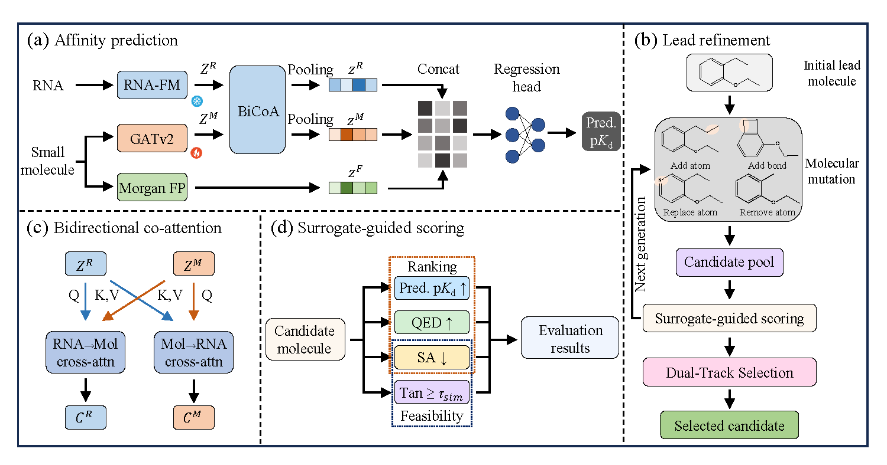

# AffiEvo-RMI

**AffiEvo-RMI** is a computational framework for **RNA–small-molecule binding affinity prediction and structure-constrained molecular optimization**. It combines multimodal affinity prediction with lead-guided evolutionary refinement to prioritize candidate molecules for a given RNA sequence.

The model predicts a continuous binding affinity value (**pKd**), rather than a binary interaction label. Its trained predictor also serves as an **affinity surrogate** during molecular optimization. Reported affinity gains are surrogate-predicted results and require independent biochemical or experimental validation.

## Overview

The overall framework of **AffiEvo-RMI** is illustrated below.



## Repository Layout

The Python imports require `predictor.py` and `optimizer.py` inside `models/`, and `chem_utils.py` and `train_metrics.py` inside `utils/`. Arrange the repository from its root as follows:

```text
AffiEvo-RMI/
├── README.md
├── requirements.txt
├── environment.yml
├── create_data.py
├── training.py
├── inference.py
├── models/
│   ├── predictor.py
│   └── optimizer.py
├── utils/
│   ├── chem_utils.py
│   ├── train_metrics.py
│   └── sascorer.py                   # Required for reliable SA scoring
├── pre-train/
│   └── RNA-FM/
│       ├── config.json
│       ├── pytorch_model.bin
│       └── ...                       # Compatible tokenizer files
├── data/
│   ├── RNA-Molecule/
│   │   ├── Molecule.xlsx
│   │   ├── RNA.xlsx
│   │   └── RNA-Molecule.xlsx
│   └── processed/                    # Generated caches, splits, statistics
├── results/
│   ├── models/                       # Trained checkpoints
│   ├── predictor/                    # Fold-level training/evaluation logs
│   └── optimizer/                    # Fold-level optimization CSV files
├── figures/
│   └── framework.png                 # Framework diagram used in this README
└── predict/
    ├── test_data.csv                 # User-provided inference input
    └── results_inference.csv         # Generated inference output
```

`data/processed/`, `results/`, and inference output files are generated during execution. `optuna.py` is optional for the main training and inference workflow. The RNA-FM weights, datasets, and trained checkpoints must be obtained or generated separately; they are not created by cloning source code.

## Environment

The supplied `environment.yml` describes an environment named **AffiEvo-RMI** with Python 3.11. The project relies on PyTorch, PyTorch Geometric, Transformers, RDKit, NumPy, pandas, SciPy, scikit-learn, and OpenPyXL.

On a compatible system, an installation attempt can start with:

```bash
conda env create -f environment.yml
conda activate AffiEvo-RMI
```

**Environment portability:** The uploaded environment files are exports of a particular Linux/CUDA setup. `requirements.txt` contains machine-local `file:///...` references and CUDA-specific package builds, so `pip install -r requirements.txt` may fail unchanged on another machine. Install compatible PyTorch/PyG wheels for your CUDA or CPU environment and adjust the dependency files as needed. The commands in this README have been checked against the script interfaces, but the complete environment has not been reproduced here.

### RNA-FM weights

Both `create_data.py` and `inference.py` read RNA-FM from:

```text
pre-train/RNA-FM/
```

Provide the matching model configuration, tokenizer assets, and weights. The current loader uses `torch.load()` for the weight file, so a PyTorch-compatible `pytorch_model.bin` is the safe format for these scripts. Although the code checks for a `model.safetensors` filename, it does not use a Safetensors-specific loader.

RNA-FM tokenization uses a maximum of **1,024 input tokens**; the downstream dataset representation is padded or truncated to **401 embedding positions** by default. These limits refer to different processing stages.

### Synthetic-accessibility scorer

`models/optimizer.py` and `utils/chem_utils.py` import the SA scorer as `from utils import sascorer`. Ensure that a compatible `utils/sascorer.py` implementation is available (or adapt these imports to an installed SA scorer). Without it, SA scores can be unavailable or replaced with failure values, making the chemical constraints and optimization-success flags unreliable.

## Data Preparation

Place three Excel workbooks under `data/RNA-Molecule/`.

| File | Required columns | Purpose |
|---|---|---|
| `Molecule.xlsx` | `Molecule_ID`, `SMILES` | Maps molecule identifiers to molecular structures |
| `RNA.xlsx` | `RNA_ID`, `RNA_Sequence` | Maps RNA identifiers to nucleotide sequences |
| `RNA-Molecule.xlsx` | `RNA_ID`, `Molecule_ID`, `pKd` | RNA–molecule pairs with **continuous numeric** binding affinity labels |

The IDs in the interaction table must match those in the molecule and RNA tables. The expected RNA column is `RNA_Sequence`, **not** `1D Sequence`; the task label is `pKd`, **not** `label`.

To prepare the default ten-fold random-interaction data separately:

```bash
python create_data.py
```

This generates RNA-FM embeddings, molecular graph and fingerprint features, train/validation/test splits, fold-specific target normalization statistics, and PyTorch Geometric caches under `data/processed/`.

You may skip the separate preparation command because `training.py` calls the data-preparation routine itself.

**Supported split in the supplied code:** `create_data.py` and `training.py` currently support `--split_mode random` only. Do not assume a molecular-scaffold split is available in this code version.

## Model Training

Run the default training configuration:

```bash
python training.py --stage train --dataset RNA-Molecule --split_mode random --n_splits 10 --seed 42
```

Training performs stratified ten-fold splitting with an inner validation subset, fits one predictor per fold, selects checkpoints based on **validation Pearson correlation**, and records regression performance. The main reported metrics include RMSE, MAE, R², Pearson correlation, and Spearman correlation. Labels are normalized using statistics from the corresponding training fold.

Default settings in `training.py` include:

| Setting | Default |
|---|---:|
| Outer folds / validation fraction | 10 / 0.1 |
| Seed / maximum epochs | 42 / 500 |
| Batch size / learning rate | 64 / 0.0005 |
| Weight decay / dropout | 0.0005 / 0.8 |
| Embedding dimension / GATv2 layers | 128 / 3 |
| Configured attention heads | 4 |
| Huber / ranking / outer auxiliary weights | 1.0 / 0.1 / 0.005 |
| Alignment / hard-mining weights | 0.05 / 2.0 |
| Pairwise ranking margin | 0.01 |

The predictor internally uses half of the configured `num_heads` value for the GATv2 and cross-attention heads, so the default command-line value of 4 corresponds to **2 heads** in those modules.

Saved predictor checkpoints follow this pattern:

```text
results/models/random_best_predictor_fold1.pt
results/models/random_best_predictor_fold2.pt
...
results/models/random_best_predictor_fold10.pt
```

Epoch-level logs are saved under `results/predictor/`.

## Evolutionary Refinement

To optimize using checkpoints already saved by a matching training run:

```bash
python training.py --stage opt --dataset RNA-Molecule --split_mode random --n_splits 10 --seed 42
```

To train and then optimize within one run:

```bash
python training.py --stage all --dataset RNA-Molecule --split_mode random --n_splits 10 --seed 42
```

The optimization defaults are:

| Setting | Default |
|---|---:|
| Evolution steps / candidate population | 50 / 80 |
| QED weight / SA weight | 1.5 / 0.08 |
| Minimum Tanimoto similarity | 0.1 |
| Maximum final SA | 5.5 |
| Minimum surrogate-predicted ΔpKd for success | 0.3 |
| Mutation probability thresholds | 0.35, 0.60, 0.80 |
| Aromatic protection probability | 0.8 |

The search ranks chemically feasible candidates with a composite score based on surrogate-predicted pKd, QED, and SA. Optimization-success flags additionally require all three conditions:

```text
predicted ΔpKd >= 0.3
final SA       <= 5.5
Tanimoto       >= 0.1
```

The `training.py` optimization stage currently constructs a **fixed, capped cohort of at most ten distinct RNA targets per outer fold**. Its `results/optimizer/` CSV files should not be described as optimizing every held-out RNA–molecule pair. For an input-defined collection of pairs, use the batch inference workflow below.

Optimization output filenames follow the pattern:

```text
results/optimizer/random_fold1_optimized_<timestamp>.csv
```

When reproducing an optimization run, keep the training-fold seed, checkpoint, fold-specific pKd normalization statistics, and optimization thresholds consistent.

## Batch Inference

`inference.py` supports two modes:

- `predict`: report surrogate-predicted initial pKd, QED, and SA, without generating candidates.
- `optimize`: report the initial prediction and run evolutionary refinement for each valid input row.

### Input file

The default input is `predict/test_data.csv`. Supply at least these two columns:

```csv
smiles,rna_sequence
CCO,AUGCUAGCUAGCUAGCUAGC
c1ccccc1,GGCAUUGCAUUGCAUUGCAU
```

The script also accepts Excel input and recognizes common alternative header spellings such as `SMILES` and `RNA_Sequence`. Empty SMILES or RNA sequences are skipped. These example rows illustrate the file format only, not expected affinity or optimization performance.

### Affinity prediction only

```bash
python inference.py --mode predict --input_file predict/test_data.csv --output_file predict/predictions.csv --model_path results/models/random_best_predictor_fold1.pt
```

The output includes:

```text
original_smiles, rna_sequence, Init_pKd, Init_QED, Init_SA
```

### Prediction with molecular optimization

```bash
python inference.py --mode optimize --input_file predict/test_data.csv --output_file predict/optimized_candidates.csv --model_path results/models/random_best_predictor_fold1.pt --opt_steps 50 --opt_candidates 80 --sim_cutoff 0.1 --sa_cutoff 5.5 --success_delta 0.3
```

The output includes initial and final surrogate-predicted pKd, predicted ΔpKd, QED and SA scores, Tanimoto similarity, optimization-success status, and selected candidate SMILES.

**Important inference constraints:**

1. The current `inference.py` uses **fold 1** and loads `data/processed/RNA-Molecule_random_fold1_train_y_stats.pt`; use a checkpoint trained on the same split and fold.
2. Preserve `data/RNA-Molecule/RNA.xlsx` for cached RNA-embedding lookup. Previously unseen sequences are embedded with the local RNA-FM model.
3. The scripts produce **predictions**, not experimentally measured binding affinities. Success flags are defined by the computational thresholds above.

## Implementation and Reproducibility Notes

- Execute commands from the repository root, with `models/` and `utils/` arranged as shown above.
- `training.py` uses `--stage train`, `--stage opt`, or `--stage all`. `inference.py` uses `--mode predict` or `--mode optimize`; the argument names are **not interchangeable**.
- `optuna.py`, when included, is a parameter-grid runner; it is not needed to use a saved predictor for inference.
- Training and inference require fold-specific normalization statistics. A checkpoint by itself is insufficient to reconstruct real-scale pKd output in the current implementation.
- The code relies on an SA scorer but does not include a replacement for missing scorer files.
- **Version compatibility to fix before execution:** The uploaded `utils/train_metrics.py` still imports `read_raw_data_Molecule_Scaffold` from `create_data.py`, but that function is absent from the uploaded `create_data.py`. Remove the stale import in both locations within `train_metrics.py` or restore a matching implementation. The current training entry point otherwise fails during import.
- The provided code has been inspected for interface and path consistency; full model training and end-to-end optimization were not run as part of this README update.

## Interpretation

AffiEvo-RMI is intended to support **computational prioritization and lead refinement** for RNA-targeted small molecules. Surrogate-predicted pKd changes, QED, SA, and similarity metrics should not be treated as experimental evidence of binding or biological activity. Independent biochemical and experimental validation remains necessary before further biological or translational use.
